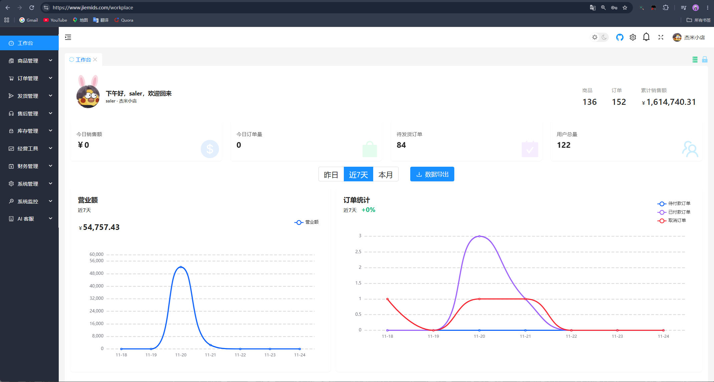
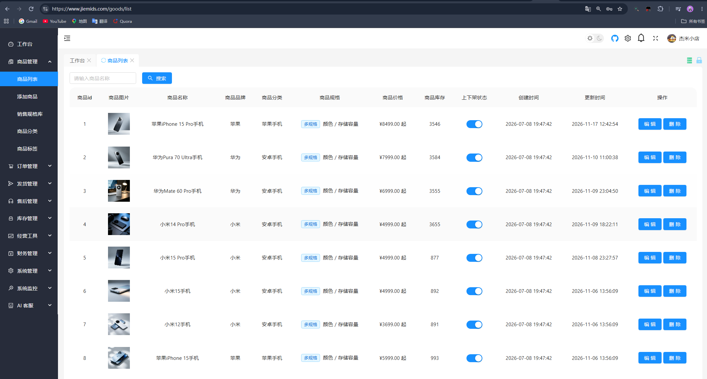

# 杰米多多 · 全栈电商系统

一套单店 B2C 电商系统，由 **Java 微服务、Python AI 服务、后台管理、PC 商城和微信小程序**组成，覆盖商品、交易、秒杀、库存、售后、财务、权限、操作审计及系统监控等完整业务链路。

## 项目组成

| 模块&nbsp;&nbsp;&nbsp;&nbsp;&nbsp;&nbsp;&nbsp;&nbsp;&nbsp;&nbsp; | 目录 | 说明 |
|---|---|---|
| Java 后端 | `e-commerce-boot` | Spring Cloud 微服务，提供商城、后台及 AI 内部业务接口 |
| Python AI 服务 | `ecommerce-python` | FastAPI + LangChain + LangGraph，提供智能客服与运营助手 |
| 后台管理 | `e-commerce-web` | Vue 3 + Ant Design Vue，覆盖运营、财务、权限与系统监控 |
| PC 商城 | `ecommerce-mall` | Vue 3 + Element Plus，与小程序共用 C 端业务接口 |
| 微信小程序 | `e-commerce-uniapp` | uni-app + Vue 3，支持微信静默登录、商城交易与 AI 客服 |

## 技术栈

| 模块&nbsp;&nbsp;&nbsp;&nbsp;&nbsp;&nbsp;&nbsp;&nbsp;&nbsp;&nbsp; | 技术 |
|---|---|
| Java 后端 | Java 17、Spring、Spring Boot、Spring MVC、Spring Cloud、Spring Cloud Gateway、OpenFeign、MyBatis / MyBatis-Plus、MySQL、Redis、Nacos、JWT、WebSocket、Docker、Nginx |
| Python 后端 | FastAPI、LangChain、LangGraph |
| 后台管理 | Vue 3、Ant Design Vue |
| PC 商城 | Vue 3、Element Plus |
| 微信小程序 | uni-app、Vue 3 |

## 后端核心功能

| 功能域&nbsp;&nbsp;&nbsp;&nbsp;&nbsp;&nbsp;&nbsp;&nbsp; | 已实现能力 |
|---|---|
| 商品与内容 | 商品、分类、规格模板、标签、评价、Banner、文章、图片及视频上传 |
| 用户与会员 | 微信 openid 静默登录、PC 账号密码 / 模拟手机验证码登录、用户资料、收货地址、会员等级、成长值、收藏与意见反馈 |
| 订单与配送 | 购物车、订单、模拟支付、包裹发货 / 补发、快递公司、物流轨迹及订单 WebSocket 推送 |
| 秒杀与营销 | 优惠券秒杀、领券中心、优惠券发放、促销活动及效果统计；秒杀支持一人一单、唯一索引兜底、乐观锁防超卖、冲突重试、15 分钟超时关单与库存回补、退款申请及后台审核 |
| 库存管理 | SKU 库存、预警阈值、库存看板、入库 / 出库 / 调整单及出入库审计流水 |
| 售后服务 | 仅退款、退货退款、换货补发、售后进度查询及后台审核 |
| 财务与报表 | 收款账户、收款单审核与导出、营业额卡片、折线报表及销售统计 |
| 权限与安全 | 管理员、角色、菜单及按钮级 RBAC 权限，用户 / 管理员双身份 JWT、图形验证码、登录失败锁定、内部接口令牌鉴权 |
| 操作审计 | AOP 操作日志采集、登录日志、条件查询及 CSV / Excel 导出 |
| 系统监控 | 主机、JVM、容器与中间件健康监控，Redis 缓存监控，MySQL、连接池与慢 SQL 监控，在线用户强制下线，动态定时任务与执行记录 |
| 系统管理 | 接口文档同步与维护、数据库表查看与优化、数据库备份、下载及删除 |
| AI 协同 | 商品、库存、订单及售后内部查询接口，通过 `X-Internal-Token` 供 Python AI 工具安全调用 |

> 当前订单与秒杀支付、PC 手机验证码为模拟实现；`file-service` 仍为骨架，商品相关上传能力由 `product-service` 提供。

## Java 微服务拆分

| 模块&nbsp;&nbsp;&nbsp;&nbsp;&nbsp;&nbsp;&nbsp;&nbsp;&nbsp;&nbsp; | 职责 |
|---|---|
| `gateway` | 统一入口、路由、跨域及静态资源代理 |
| `auth-service` | 后台登录、图形验证码、失败锁定及 RBAC 权限签发 |
| `user-service` | 小程序 / PC 登录、用户资料、会员与意见反馈 |
| `product-service` | 商品、分类、规格、标签、Banner、文章、促销、收藏、库存及文件上传 |
| `order-service` | 购物车、地址、订单、模拟支付、配送、优惠券、秒杀、评价、财务及报表 |
| `aftersale-service` | 仅退款、退货退款、换货补发及售后审核 |
| `system-service` | 系统管理、操作与登录日志、系统监控、接口及数据库管理 |
| `file-service` | 独立文件服务骨架 |
| `common` | JWT 与内部接口鉴权、操作日志、慢 SQL 采集、定时任务、异常处理等公共能力 |

## 项目目录

```text
ecommerce-workspace/
├── e-commerce-boot/       Java 微服务后端
├── ecommerce-python/      Python AI 客服与运营助手
├── e-commerce-web/        后台管理系统
├── ecommerce-mall/        PC 商城
└── e-commerce-uniapp/     微信小程序商城
```

## 系统截图

### 电商后台管理系统

| 工作台 | 商品管理 |
|:---:|:---:|
|  |  |

### PC 商城

| 首页 | 商品详情 |
|:---:|:---:|
|  |  |

### 微信小程序

| 首页 | 商品详情 | 提交订单 |
|:---:|:---:|:---:|
|  |  |  |

<p align="center">
  
  <br>微信扫码进入小程序
</p>

## **演示地址**

| 端&nbsp;&nbsp;&nbsp;&nbsp;&nbsp;&nbsp; | 地址 |
|---|---|
| 微信小程序 | 杰米多多（扫描上方小程序码） |
| 后台管理 | https://www.jiemids.com |
| PC 商城 | https://www.xiaojiecpn.com |

## 联系方式

- QQ：3100326817
- 邮箱：3100326817@qq.com

## 本地运行

### 1. 准备基础设施

准备 MySQL、Redis，并启动 Nacos：

```bash
cd e-commerce-boot/deploy
docker compose up -d nacos
```

### 2. 导入演示数据

`e-commerce-boot/sql/e_commerce_db.sql` 为脱敏数据库快照，包含演示商品、订单、评价及知识库等数据：

```bash
mysql -u<用户> -p -D e_commerce_db --default-character-set=utf8mb4 < e-commerce-boot/sql/e_commerce_db.sql
```

### 3. 配置并启动各模块

- 为 Java 各业务服务准备 `application-dev.yml`，启动网关及所需业务服务。
- 根据 `ecommerce-python/.env.example` 创建 `.env`，启动 Python AI 服务。
- 按各前端模块文档安装依赖并启动开发环境。
- 数据库结构变更脚本位于 `e-commerce-boot/docs/sql/`，本地与生产环境应执行同一脚本。

详细配置、启动及发布方式见下方各模块文档。

## 文档索引

| 文档 | 内容 |
|---|---|
| [Java 后端说明](e-commerce-boot/README.md) | 微服务技术栈、服务职责、开发与部署 |
| [Python AI 服务说明](ecommerce-python/README.md) | AI 架构、工具集、接口、鉴权与运行方式 |
| [后台管理说明](e-commerce-web/README.md) | 管理功能、权限、前端运行与发布 |
| [PC 商城说明](ecommerce-mall/README.md) | 商城页面、接口代理、运行与发布 |
| [微信小程序说明](e-commerce-uniapp/README.md) | 小程序功能、分包、运行与发布 |
| [部署手册](e-commerce-boot/deploy/README.md) | Docker、Nginx、发布与备份 |
| [数据库脚本说明](e-commerce-boot/docs/sql/README.md) | SQL 脚本分类、执行方式与幂等约定 |
